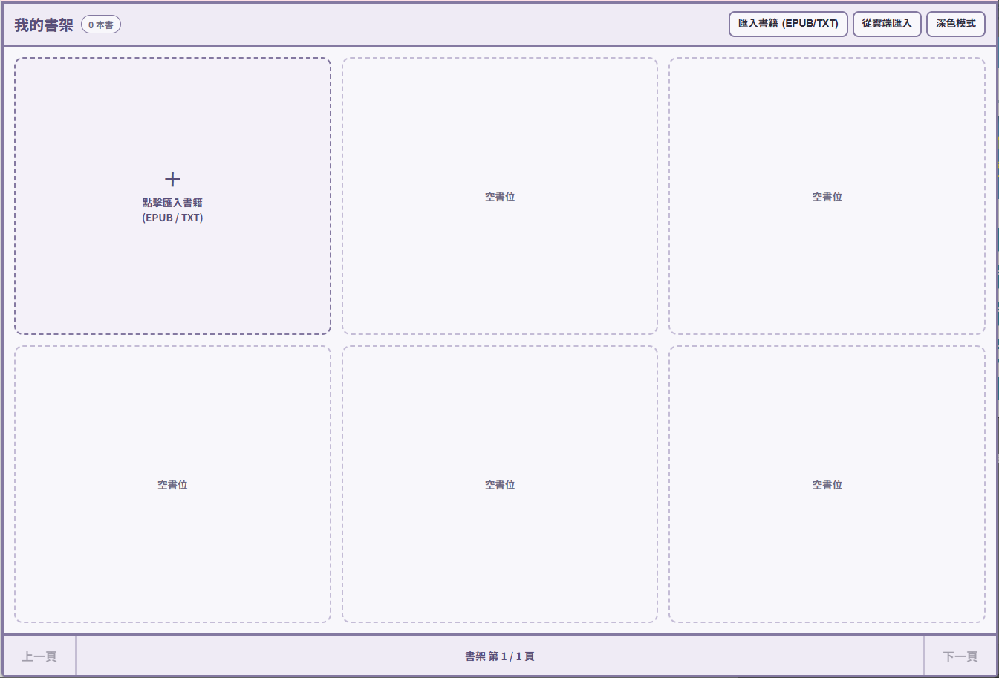
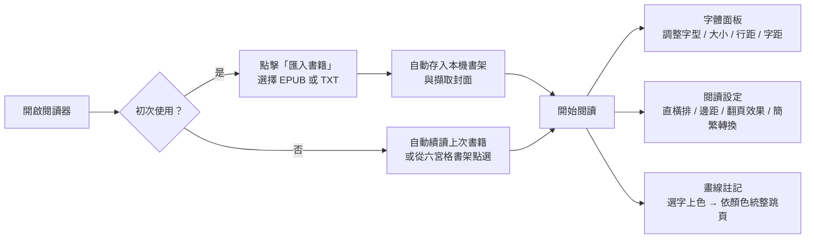

# 📖 E-Ink 專屬離線版電子書閱讀器

> 專為 **電子紙平板（BOOX / HyRead / Meebook）**、**Android 手機** 與 **電腦瀏覽器** 打造的 100% 離線電子書閱讀器。
>
> 採用溫潤護眼的 **淡莫蘭迪藍紫風格** 搭配 **極淡紫色小花瓣布紋背景**，支援 **EPUB / TXT 雙格式**、**六宮格自動記憶書架**、**30MB+ 超大書檔極速載入**，以及專為推理小說設計的 **畫線分色統整與跳頁** 功能！

## ✨ 核心功能亮點

| 功能分類 | 特色說明 |
| ----- | ----- |
| **📚 六宮格離線書架** | 固定以六宮格（電腦 `3×2`／手機 `2×3`）展示讀過的書籍，自動擷取 EPUB 封面（TXT 自動產生書籍圖示＋書名封面），即時顯示 **書名、閱讀進度條與百分比**，重開 App 自動續讀上次進度。 |
| **⚡ 30MB+ 極速引擎** | 針對大型輕小說與長篇 EPUB 啟用「**極速按需解壓模式**」，開書秒進第一頁，翻到哪章才解壓該頁插圖，並自動依裝置視窗等比例縮放圖片（含 SVG 封面），絕不跑出格。 |
| **🔍 推理小說畫線統整** | 內建 6 種柔和螢光色（粉紅、黃、橘、綠、藍、紫），提供「**畫線統整清單**」，可**依顏色篩選**所有線索與重點，點擊文字直接跳轉至該頁。 |
| **📐 防切字精準排版** | 支援 **橫排（左→右）** 與 **直排（右→左）**，提供獨立的 **上下邊距／左右邊距** 拉條，自動對齊整數行數，徹底消除邊緣文字被切一半的問題；自動清除 EPUB 原檔寫死的白底與固定字體。 |
| **🖋️ 專屬字體與簡繁轉換** | 內建 **LINE Seed、清松手寫體、芫荽體注音版**，並支援匯入本機字體檔（`.ttf / .otf / .woff2`）永久離線保存；支援 **字體大小、行距、字距** 調整與離線 **簡體↔繁體即時轉換**。 |
| **🌊 多種翻頁體驗** | 提供「**沒有效果（電子紙推薦）**」、「**水波紋效果（Kindle 柔滑掃描）**」、「**翻書頁的效果（3D 折頁）**」三種模式，支援按鈕、觸控滑動與鍵盤方向鍵。 |
| **🔤 智慧 TXT 防亂碼** | 內建智慧中文編碼評分偵測（自動辨識 UTF-8 / Big5 / GB18030 / UTF-16），並可於閱讀設定手動即時切換編碼不掉頁。 |

## 🖼️ 圖文介面導覽

### 1. 六宮格書架畫面



* 以清楚的六宮格呈現已讀過的書籍，點擊空白書位的 `＋` 即可快速匯入本機 EPUB / TXT 電子書。
* 右上方提供 **匯入書籍**、**從雲端匯入** 與 **深色模式** 一鍵切換，底部支援多頁書架翻頁。

### 2. 閱讀畫面單排工具列（電腦／電子紙／手機皆維持單排）


* 頂部整合 **回到書架、匯入書籍、雲端匯入、選擇章節、畫線註記、書籤、字體、閱讀設定** 等完整功能，無論電腦、電子紙或手機皆維持俐落單排。
* 內文搭配極淡紫色小花瓣布紋背景與精準邊距對齊，底部即時顯示本章頁數與全書進度百分比。

### 3. 快速上手使用流程



## 📖 詳細使用教學

### 第一步：匯入書籍（本機或雲端）

1. 在書架首頁或閱讀畫面中，點擊 **「匯入書籍 (EPUB/TXT)」**（或直接點擊書架中的 `＋` 空書位）。
2. 選擇裝置內的 `.epub` 或 `.txt` 檔案，系統會自動判斷格式並存入本機離線資料庫（IndexedDB）。
3. 若書籍檔案放在公開網路空間，也可點擊 **「雲端匯入」** 貼上連結直接下載匯入。

### 第二步：翻頁與章節跳轉

* **按鈕翻頁**：點擊底部左右兩側的 **「上一頁」**、**「下一頁」**。
* **觸控手勢**：在閱讀區左右滑動即可翻頁（自動配合橫排／直排方向調整滑動方向）。
* **鍵盤操作**：使用鍵盤 `←` / `→` 方向鍵翻頁。
* **章節目錄**：點擊左上角 **「選擇章節」** 可快速瀏覽與跳轉 EPUB 目錄（支援簡繁同步轉換）。

### 第三步：畫線註記與顏色篩選（推理小說必備！）

1. 在內文中用滑鼠拖曳或手指長按選取想要標記的文字（選取成功時，右上角「畫線註記」按鈕會自動反白提示）。
2. 點擊 **「畫線註記」**，挑選 6 種螢光色之一（例如：粉紅＝嫌疑人、黃色＝時間軸、藍色＝關鍵證據）。
3. 點擊選單中的 **「畫線統整清單」**，可透過上方色點快速篩選特定顏色的所有紀錄，點擊任一條目即可**直接跳轉回該頁**！

### 第四步：客製化字體與閱讀設定

* **點開右上角「字體」**：
  * 切換系統字體（**LINE Seed、清松手寫體、芫荽體注音版**），或匯入您收藏的 `.ttf / .otf / .woff2` 字體檔（永久離線保存）。
  * 即時拖曳調整 **字體大小**、**行距** 與 **字距**。
* **點開右上角「閱讀設定」**：
  * **閱讀方向**：一鍵切換橫排（左→右）或直排（右→左）。
  * **上下／左右邊距**：自由調整留白距離（`8px`～`80px`），文字自動對齊整數行數不切字。
  * **翻頁效果**：選擇「沒有效果」、「水波紋效果（Kindle 風格）」或「翻書頁的效果」。
  * **簡繁中文轉換**：可即時切換「原文」、「簡體轉繁體」、「繁體轉簡體」。
  * **畫面主題與背景**：切換深色模式、調整花瓣背景淡度，或匯入個人喜愛的背景圖片。

## 📱 安裝為 100% 離線 App（PWA 教學）

不需要額外打包 APK，只要透過瀏覽器即可安裝成獨立全螢幕 App，**關閉 Wi-Fi 也能完整使用**：

1. 在電子紙平板或 Android 手機上，用 **Chrome / Edge** 開啟您的 GitHub Pages 網址。
2. 等待頁面完整載入（確認設定中的離線引擎狀態顯示「已就緒」）。
3. 點擊瀏覽器右上角選單 **`⋮`** → 選擇 **「安裝應用程式」**（或「加到主畫面」→「安裝」）。
4. 回到桌面點擊閱讀器圖示，即可享受**無網址列、全螢幕、完全離線**的閱讀體驗！

## 📂 專案檔案結構

```text
.
├── index.html            # 閱讀器主程式（單檔整合介面、排版引擎、書架與離線儲存）
├── manifest.json         # PWA 應用程式設定檔（名稱、主題色、圖示）
├── sw.js                 # Service Worker 離線快取腳本
├── bookmark_2.png        # 書籤與 App 桌面圖示
├── README.md             # 本專案說明文件
├── screenshots/          # 實機介面截圖資料夾
│   ├── bookshelf.png     # 六宮格書架截圖
│   └── reader.jpg        # 閱讀畫面截圖
└── libs/                 # 本機離線核心函式庫（免網路運作必備）
    ├── jszip.min.js      # EPUB 壓縮檔解壓引擎
    └── epub.min.js       # EPUB 渲染引擎
```

## 🔄 更新維護小提醒

日後若修改了 `index.html` 並上傳覆蓋至 GitHub，請記得同步打開 `sw.js`，將第一行的快取版本號加一（例如從 `v19` 改為 `v20`）一併上傳。電子紙與手機在重新整理兩次後，就會自動清除舊快取並套用最新版本！